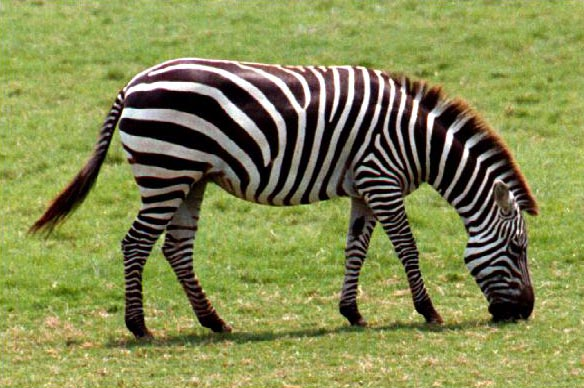

# Super-Resolution Research by playing with Deep Image Prior 
We choose super resolution as the task due to it's complexity and with works still being published as discussed in the class. 

## Problem Formulation 
The goal of super-resolution is to take a low resolution (LR) image x0 ∈ R3×H×W and upsampling factor t, and generate a corresponding high resolution (HR) version x ∈ R3×tH×tW .

Upsampling factor t is something that's needed to be chosen prehand. 
We use t=4 in the whole of the experiments 

Thus, Super-Resolution (SR) aims to invert the forward degradation process:
$$y = A(X) + \eta$$
where:
- $X \in \mathbb{R}^{3 \times R \times H}$ is the unknown ground truth High-Resolution (HR) image.
- $A(\cdot)$ is the 4x spatial downsampling operator (Lanczos-2 kernel with anti-aliasing).
- $y \in \mathbb{R}^{3 \times R/4 \times H/4}$ is the observed Low-Resolution (LR) input image.
- $\eta$ is measurement noise.

### Strict Real-World Constraint: Zero-Shot / Single-Image Learning
In practical scenarios, external high-resolution training datasets are unavailable or unrepresentative of real camera degradations. Therefore, all methods evaluated here strictly adhere to **single-image unsupervised learning**:
> **The ground-truth HR image $X$ is NEVER exposed during training.**
> Any learning or optimization is driven solely by the input observation $y$ and the degradation operator $A$.

## Evaluation Strategy 

### Test Data 

DIP [1] uses Set5 [2] and Set14 [3] datasets. We constrain ourselves to Set14 dataset. Most of the inital experiments have been carried out only on a single image of Set 14. 

Original HR Image of R*3×576×384

The dimentions of all images in Set 14 dataset are available 

### Metric 

We use PSNR as the metric for comparision calculated with using checkpoint of model with best psnr during the whole run.(Average PSNR in the case of Set 14 Dataset) as followed by [1][4].

## Models

### Conventional Baseline 
As used in DIP[1], Conventional Baseline is Bicubic Interpolation and Nearest Neighbor.

### Deep Image Prior 
Our baseline comparision is with DIP[1].
DIP uses an fully-convolutional architectures, where the input z ∈ RC′×W ×H has the same spatial resolution as the the output of the network fθ (z) ∈ R3×W ×H . It uses an hour glass architecture. The hyperparameter details are kept same as what's presented in the paper 

z ∈ R32×W ×H ∼ U (0, 0.1 )
nu = nd = [128, 128, 128, 128, 128]
ku = kd = [3, 3, 3, 3, 3]
ns = [4, 4, 4, 4, 4]
ks = [1, 1, 1, 1, 1]
σp = 1
30
num iter = 2000
LR = 0.01
upsampling = bilinear

Note: Upsampling is not learned, it's kept as unlearned and as mentioned in DIP[1], the results obtained were worse. 

**Principle**: Fits the parameters $\theta$ of an untrained skip convolutional generator $f_\theta(z)$ directly to the LR image $y$:
  $$\min_\theta \| A(f_\theta(z)) - y \|_2^2$$
  where $z \sim \mathcal{N}(0, 0.1 \cdot \mathbf{I})$ is a fixed spatial noise tensor.

For more details refer to DIP[1].

---

## Changing the architecture 
It was carried out to explore how different neural network architectures perform as the generative prior in the Deep Image Prior (DIP) framework for 4x Super-Resolution to investigates which architectural inductive bias works best when optimizing on a single image without any external dataset training.

Explored models are 

* unet (models.unet.UNet): Classic U-Net encoder-decoder (~2.16M parameters).
* resnet (models.resnet.ResNet): Deep Residual Network prior with 10 residual blocks (~797k parameters).
* swin (models.swin.swin): Vision Transformer prior using Swin Transformer shifted window attention (~2.88M parameters).
* swin_skip (models.swin_skip.swin_skip): Recursive Swin Transformer equipped with multi-scale skip connections (~4.68M parameters).
* Dpwise-346K,100K: DIP[1] Architecture with 3d conv replaced with depth wise seperable convolutions.  (Note : 2500 iterations were used in this case)

### DIP + Regularization by Denoising [4]
- **Principle**: Incorporates an explicit cross-scale denoiser $D(\cdot)$ as an engine of regularization (RED):
  $$\mathcal{L}(\theta) = \frac{1}{2} \| A f_\theta(z) - y \|_2^2 + \frac{\lambda_{\text{RED}}}{2} f_\theta(z)^T \Big( f_\theta(z) - D(f_\theta(z)) \Big) + \lambda_{\text{TV}} \text{TV}(f_\theta(z))$$
- **Parameters**: $\lambda_{\text{RED}} = 0.005$, $\lambda_{\text{TV}} = 10^{-8}$

---

### Single-Image Internal Learning (ZSSR-style UNet) [5]
- **Principle**: 
  This approach trains an image-specific neural network exclusively on the internal cross-scale self-similarity of the single input image y.
  Leverages internal cross-scale recurrence (self-similarity across scales within a natural image).
- **Internal Dataset Construction (from $y$ alone)**:
  1. Extract random crops $P_{\text{hr\_sub}} \subset y$ of sizes $48 \times 48$.
  2. Apply data augmentations: 4 discrete rotation angles ($0^\circ, 90^\circ, 180^\circ, 270^\circ$) and random horizontal/vertical flips.
  3. Downsample each augmented crop using the degradation operator $A$ to yield $P_{\text{lr\_sub}} \in \mathbb{R}^{3 \times 12 \times 12}$.
  4. Yields a self-supervised internal training dataset of 256 pairs $(P_{\text{lr\_sub}}, P_{\text{hr\_sub}})$.
- **Architecture**: Residual UNet predicting high-frequency residual $\Delta$:
  $$\hat{P}_{\text{hr}} = \text{Bicubic}(P_{\text{lr\_sub}}) + \Delta_\theta(\text{Bicubic}(P_{\text{lr\_sub}}))$$
- **Objective**: Charbonnier smooth L1 loss + Total Variation penalty:
  $$\mathcal{L} = \sqrt{\|\hat{P}_{\text{hr}} - P_{\text{hr\_sub}}\|^2 + \epsilon^2} + \lambda_{\text{TV}} \text{TV}(\hat{P}_{\text{hr}})$$
- **Test-Time Inference & Back-Projection**:
  After training terminates on the patch dataset, the **entire full image $y$** is passed through the network:
  $$\hat{X}^{(0)} = \text{Model}(y)$$
  Followed by iterative back-projection data consistency:
  $$\hat{X}^{(k+1)} = \hat{X}^{(k)} + \mu \cdot \text{Bicubic}\Big(y - A(\hat{X}^{(k)})\Big)$$

---

### Single-Image Conditional Diffusion Model (Score-Based SR) Inspired by DDIM [6]

#### 1. Why Diffusion / Score-Based Modeling?
Traditional regression models suffer from the "regression to the mean" problem (blurring uncertain high frequencies). A conditional score-based diffusion model generates sharp, realistic edge distributions conditioned on the low-resolution image.

#### 2. Noise Schedule & Forward Process
- **Total Timesteps**: $T = 300$.
- **Beta Schedule**: Linear variance schedule $\beta_t \in [10^{-4}, 0.02]$.
- **Cumulative Alphas**:
  $$\alpha_t = 1 - \beta_t, \quad \bar{\alpha}_t = \prod_{s=1}^t \alpha_s$$
- **Forward Noising Equation**:
  $$q(x_t \mid x_0) = \mathcal{N}\Big(\sqrt{\bar{\alpha}_t} x_0, (1 - \bar{\alpha}_t)\mathbf{I}\Big) \implies x_t = \sqrt{\bar{\alpha}_t} x_0 + \sqrt{1 - \bar{\alpha}_t} \epsilon, \quad \epsilon \sim \mathcal{N}(0, \mathbf{I})$$

#### 3. Training Architecture & Objective
- **Conditioning**: $c = \text{Bicubic}(P_{\text{lr}})$, upsampled to match the resolution of $P_{\text{hr}}$.
- **Score Network**: `ConditionalDiffusionUNet` with sinusoidal time embeddings:
  $$\epsilon_\theta(x_t, t, c)$$
- **Training Loss**: Denoising Score Matching:
  $$\mathcal{L}_{\text{diff}}(\theta) = \mathbb{E}_{t, x_0, \epsilon} \Big[ \| \epsilon_\theta(x_t, t, c) - \epsilon \|_2^2 \Big]$$
  Randomly samples $t \sim \mathcal{U}\{0, T-1\}$, adds noise to internal patch $x_0 = P_{\text{hr}}$, and trains $\epsilon_\theta$ to predict the injected noise.

#### 4. Inference & Diffusion Posterior Sampling (DPS)
- **Reverse Trajectory**: Subsampled $S = 50$ DDIM-style steps spanning $t = 299 \rightarrow 0$.
- **Starting Point**: Pure Gaussian noise $x_T \sim \mathcal{N}(0, \mathbf{I})$ at full target resolution ($576 \times 384$).
- **Conditioning Input**: $c = \text{Bicubic}(y)$.
- **Measurement Consistency Projection**:
  At each reverse step $t$, the predicted clean image $\hat{x}_0$ is projected toward the measurement constraint:
  $$\hat{x}_0 = \frac{x_t - \sqrt{1 - \bar{\alpha}_t} \epsilon_\theta(x_t, t, c)}{\sqrt{\bar{\alpha}_t}}$$
  $$\hat{x}_0 \leftarrow \text{clamp}\Big(\hat{x}_0 + \gamma \cdot \text{Bicubic}\big(y - A(\hat{x}_0)\big), 0, 1\Big)$$
  guaranteeing that the generated super-resolution output strictly downsamples back to the observed input $y$.

### Changing the Regularization 
#### Edge-Guided Null-Space & Contour DIP (EGNC-DIP)

## A Novel Super-Resolution-Specific Regularization Framework for Deep Image Prior

### Motivation and SR-Specific Physics

In super-resolution (SR), the forward degradation operator \(A: \mathrm{HR} \rightarrow \mathrm{LR}\) maps a high-resolution (HR) image to a low-resolution (LR) image. Its null space is defined as

\[
\mathcal{N}(A)=\{h : A(h)\approx 0\}.
\]

Any high-frequency artifact \(h\) in the null space incurs approximately zero additional data loss:

\[
\|A(f_\theta(z)+h)-y\|^2
\approx
\|A(f_\theta(z))-y\|^2.
\]

Vanilla Deep Image Prior (DIP) can introduce spurious high-frequency noise and checkerboard artifacts in this null space during late optimization (typically beyond 3,000 steps).

### Proposed SR-Specific Regularizer

#### 1. Flat-Region Null-Space Suppression

In flat regions of the LR image, where the gradient magnitude of the upsampled image is small, high-frequency content that is unsupported by the observations may correspond to spurious noise.

We penalize deviations from the bicubic reconstruction:

\[
R_{\mathrm{flat}}
=
\left\|
(1-M_{\mathrm{edge}})
\odot
\left(
f_\theta(z)-\operatorname{Bicubic}(A(f_\theta(z)))
\right)
\right\|_2^2.
\]

Here, \(M_{\mathrm{edge}}\) is an edge mask, and \(\odot\) denotes element-wise multiplication.

#### 2. Edge-Contour Tangential Continuity

In natural images, true edges—such as zebra stripes—often form locally continuous contours with relatively small intensity variation along the tangent direction. Given the image gradient \(\nabla f_\theta(z)=(f_x,f_y)\), define the tangent direction as

\[
t=(-f_y,f_x).
\]

We penalize variations along the tangent direction within edge regions:

\[
R_{\mathrm{contour}}
=
\left\|
M_{\mathrm{edge}}
\odot
\left(\nabla f_\theta(z)\cdot t\right)
\right\|_1.
\]

This regularizer encourages smooth, continuous edge contours while preserving sharp transitions across edges and suppressing jagged artifacts.

### Changing the Loss Function

#### L1 
Replacing L2 Loss with L1 Loss

#### TV
Replacing L2 Loss with TV Loss

#### Structure Tensor Coherence Regularized DIP (ST-DIP)

A novel Super-Resolution loss functin that exploits the eigensystem of the local Structure Tensor
to eliminate multi-directional high-frequency noise and checkerboard artifacts without blurring edges.

- **Mathematical Principle**:
  Analyzes the local 2D gradient orientation via the smoothed structure tensor:
  $$J_\rho = K_\rho * \begin{bmatrix} I_x^2 & I_x I_y \\ I_x I_y & I_y^2 \end{bmatrix}$$
  where the eigenvalues $\mu_1 \ge \mu_2 \ge 0$ define the local geometry:
  - $\mu_1$: Gradient energy along the dominant edge normal.
  - $\mu_2$: Spurious gradient energy perpendicular to the dominant orientation (isotropic noise, null-space wiggles, checkerboards).
  - Local Anisotropy / Coherence: $C = \left(\frac{\mu_1 - \mu_2}{\mu_1 + \mu_2 + \epsilon}\right)^2$.
  - Regularization Penalty:
    $$\mathcal{L}_{\text{ST}} = \frac{1}{|\Omega|} \sum_{(x,y)} \mu_2(x, y)$$
- **Why ST-DIP is Uniquely Suited for SR**:
  Natural edges (e.g., zebra stripes) have rank-1 structure tensors ($\mu_1 \gg 0, \mu_2 \approx 0$). In contrast, DIP null-space noise and checkerboard artifacts produce non-zero $\mu_2$ everywhere. Minimizing $\mu_2$ specifically purges non-directional noise without blunting stripe contrast!

---

#### Wavelet High-Frequency Sparsity & Directional Cross-Band DIP (Wavelet-DIP)

A novel Super-Resolution loss function that operates in the discrete wavelet transform (DWT) domain.

- **Mathematical Principle**:
  Applies an orthonormal 2D Discrete Wavelet Transform (DWT) decomposing $\hat{X}$ into subbands:
  $$[LL, LH, HL, HH] = \text{DWT}_{2D}(\hat{X})$$
  1. **Besov Sparsity Prior**:
     $$\mathcal{L}_{\text{sparse}} = \|LH\|_1 + \|HL\|_1 + 2 \cdot \|HH\|_1$$
  2. **Directional Cross-Band Mutual Exclusivity**:
     Physical stripes are purely horizontal ($LH \gg 0, HL \approx 0$) or purely vertical ($HL \gg 0, LH \approx 0$). Spurious DIP checkerboard artifacts create simultaneous energy in both ($|LH| \cdot |HL| \gg 0$).
     $$\mathcal{L}_{\text{cross}} = \| |LH| \odot |HL| \|_1$$
- **Artifacts Saved**: [`output_dip_wavelet/`](output_dip_wavelet/)
- **W&B Run**: `dip_wavelet_sr_zebra_x4_seed_0`

---

#### Euler's Elastica Level-Line Curvature Regularized DIP (Elastica-DIP)
A novel Super-Resolution loss function rooted in differential geometry and variational mechanics.

- **Mathematical Principle**:
  Rooted in Euler (1744) and Mumford-Shah variational geometry:
  $$\mathcal{L}_{\text{elastica}} = \int_\Omega (\alpha + \beta \kappa^2) |\nabla I|_\epsilon \, dx dy$$
  where $\kappa = \text{div}\left(\frac{\nabla I}{|\nabla I|_\epsilon}\right)$ is the curvature of the image level lines (isophotes).
  - Penalizes level-line bending energy ($\kappa^2 |\nabla I|_\epsilon$), eliminating high-frequency oscillations while keeping smooth stripe contours perfectly intact.

**Physical Justification for Super-Resolution:**
  1. High-frequency null-space noise and checkerboard artifacts cause rapid spatial oscillations
     in the isophote orientation, causing \\kappa^2 to explode.
  2. True physical edges (e.g. zebra stripes, boundaries) have smooth, coherent level-line trajectories
     with near-zero curvature (\\kappa \\approx 0).
  3. By penalizing level-line bending energy (\\kappa^2 |\\nabla I|), Elastica selectively extinguishes
     chaotic null-space fluctuations while completely preserving sharp, low-curvature stripe edges!

---

#### Spectral Power-Law Decay DIP (Spectral-DIP)

A novel Super-Resolution loss function operating in the 2D Fourier Frequency domain.
- **Mathematical Principle**:
  Natural images adhere to Field's (1987) universal power law:
  $$S(r) \propto r^{-2\alpha}, \quad \alpha \approx 1$$
  where $S(r)$ is the radially averaged Fourier power spectrum at spatial frequency radius $r$.
  For spatial frequencies in the null-space $r > r_{\text{cutoff}} = 1/(2 \times \text{factor})$, the downsampling operator provides 0 supervision.
  Spectral-DIP penalizes any high-frequency spectral violation where power fails to decay at the physical $r^{-2}$ rate:
  $$\mathcal{L}_{\text{spectral}} = \sum_{k \ge k_{\text{cutoff}}} \text{ReLU}\left(\log E_{k+1} - \log E_k + 2 \log(r_{k+1}/r_k)\right)^2$$

### Architecture + Loss Function

Dpwise-346K,100K-DeepRED: DIP[1] Architecture with 3d conv replaced with depth wise seperable convolutions and using DeepRED Loss function.  (Note : 2500 iterations were used in this case)

## Training Configuration
Since one of the major concerns of DIP[1] is that we don't known when to stop. All the experiments apart few (mentioned specifically) used 6000 iterations

Optimizer and learning rate was kept same as DIP[1] which is ADAM optimizer. 

## Results on Single Image 
### 6000 Steps

| Experiment     | What changed?  | Method                                           | Parameters | PSNR vs Real HR (dB) | Gain vs Bicubic (dB) | Gain vs Vanilla DIP (dB) | Artifact Directory               | W&B Run                              |
| -------------- | -------------- | ------------------------------------------------ | ---------- | -------------------- | -------------------- | ------------------------ | -------------------------------- | ------------------------------------ |
| Baseline       | Baseline       | Nearest Neighbor                                 | 0          | 20.82 dB             | -2.28                | -3.92                    | output_dip_sr/                   | -                                    |
| Baseline       | Baseline       | Bicubic Interpolation                            | 0          | 23.10 dB             | 0                    | -1.64                    | output_dip_sr/                   | -                                    |
| Baseline       | Baseline       | Vanilla DIP (Skip UNet)                          | 2217831    | 24.74 dB             | 1.64                 | 0                        | output_dip_sr/                   | dip_sr_zebra_x4_seed_0               |
| Regularization | Regularization | DIP + Regularization by Denoising (Deep Red)     |            | 24.81 dB             | 1.71                 | 0.07                     | output_dip_red/                  | dip_red_sr_zebra_x4_seed_0           |
| Loss Function  | Loss Function  | L1                                               |            | 25.08                | 1.98                 | 0.34                     | output_dip_losses_sr             | skip_losses_zebra                    |
| Loss Function  | Loss Function  | TV                                               |            | 25.14                | 2.04                 | 0.4                      | output_dip_losses_sr             | skip_losses_zebra                    |
| Loss Function  | Loss Function  | Internal ZSSR UNet                               |            | 20.96 dB             | -2.14                | -3.78                    | output_single_image_internal_sr/ | zssr_internal_sr_zebra_x4_seed_0     |
| Loss Function  | Loss Function  | Single-Image Conditional DDPM                    |            | 20.66 dB             | -2.44                | -4.08                    | output_single_image_ddpm_sr/     | single_image_ddpm_sr_zebra_x4_seed_0 |
| Loss Function  | Loss Function  | Edge-Guided Null-Space & Contour DIP (EGNC-DIP)  |            | 24.88 dB             | 1.78                 | 0.14                     | output_dip_contour_sr/           | dip_egnc_sr_zebra_x4_seed_0          |
| Loss Function  | Loss Function  | Structure Tensor Coherence DIP (ST-DIP)          |            | 25.06 dB             | 1.96                 | 0.32                     | output_dip_structure_tensor/     | dip_st_sr_zebra_x4_seed_0            |
| Loss Function  | Loss Function  | Wavelet Sparsity & Directional DIP (Wavelet-DIP) |            | 23.64 dB             | 0.54                 | -1.1                     | output_dip_wavelet/              | dip_wavelet_sr_zebra_x4_seed_0       |
| Loss Function  | Loss Function  | Euler's Elastica Curvature DIP (Elastica-DIP)    |            | 24.87 dB             | 1.77                 | 0.13                     | output_dip_elastica/             | dip_elastica_sr_zebra_x4_seed_0      |
| Loss Function  | Loss Function  | Spectral Power-Law Decay DIP (Spectral-DIP)      |            | 24.71 dB             | 1.61                 | -0.03                    | output_dip_spectral/             | dip_spectral_sr_zebra_x4_seed_0      |
| Architecture   | Architecture   | U-Net                                            | 2164899    | 24.09                | 0.99                 | -0.65                    | output_all_models_sr_1           | all_models_sr_zebra_x4               |
| Architecture   | Architecture   | ResNet                                           | 797123     | 16.49                | -6.61                | -8.25                    | output_all_models_sr_2           | all_models_sr_zebra_x5               |
| Architecture   | Architecture   | Swin Transformer                                 | 2887303    | 23.06                | -0.04                | -1.68                    | output_all_models_sr_3           | all_models_sr_zebra_x6               |
| Architecture   | Architecture   | Swin + Skip                                      | 4687663    | 22.62                | -0.48                | -2.12                    | output_all_models_sr_4           | all_models_sr_zebra_x7               |

### 2500 Steps

| Experiment                   | What changed?                | Method              | Parameters | PSNR vs Real HR (dB) | Gain vs Bicubic (dB) | Gain vs Vanilla DIP (dB) | Artifact Directory    | W&B Run           |
| ---------------------------- | ---------------------------- | ------------------- | ---------- | -------------------- | -------------------- | ------------------------ | --------------------- | ----------------- |
| Architecture                 | Architecture                 | Dpwise-346K         | 346171     | 23.88                | 0.78                 | -0.86                    | output_zebra_scaling/ | dip-zebra-scaling |
| Architecture + Loss Function | Architecture + Loss Function | Dpwise-346K-DeepRED | 346171     | 24.04                | 0.94                 | -0.7                     | output_zebra_scaling/ | dip-zebra-scaling |
| Architecture                 | Architecture                 | Dpwise-1M           | 1013851    | 24.59                | 1.49                 | -0.15                    | output_zebra_scaling/ | dip-zebra-scaling |
| Architecture + Loss Function | Architecture + Loss Function | Dpwise-1M-DeepRED   | 1013851    | 24.56                | 1.46                 | -0.18                    | output_zebra_scaling/ | dip-zebra-scaling |

### 4000 Iterations

| Experiment                   | What changed?                | Method                       | Parameters | PSNR vs Real HR (dB) | Gain vs Bicubic (dB) | Gain vs Vanilla DIP (dB) | Artifact Directory          | W&B Run            |
| ---------------------------- | ---------------------------- | ---------------------------- | ---------- | -------------------- | -------------------- | ------------------------ | --------------------------- | ------------------ |
| Architecture                 | Architecture                 | Convnext                     |            | 24.9                 | 1.8                  | 0.16                     | output_convnext_multi_image | dip-convnext-multi |
| Architecture + Loss Function | Architecture + Loss Function | Convnext + Red Loss Function |            | 24.9                 | 1.8                  | 0.16                     | output_convnext_multi_image | dip-convnext-multi |

## Results on Set 14 

After running for 4000 iterations.
Artifact Directory 	output_convnext_multi_image, output_multi_image_sr

| **Image** | **Bicubic (dB)** | **Skip-L2 (DIP)(dB)** | **Skip-DeepRED (dB)** | **DPwise-L2 (dB)** | **DPwise-DeepRED (dB)** | **ConvNeXt-L2 (dB)** | **ConvNeXt-RED (dB)** |
| --------- | ---------------- | ---------------- | --------------------- | ------------------ | ----------------------- | -------------------- | --------------------- |
| img_001   | 20.31            | 20.44 (+0.13)    | 20.45 (+0.14)         | 20.29 (−0.02)      | 20.23 (−0.08)           | 20.51 (+0.20)        | 20.52 (+0.21)         |
| img_002   | 23.58            | 23.91 (+0.33)    | 23.91 (+0.33)         | 23.53 (−0.05)      | 23.51 (−0.07)           | 23.94 (+0.36)        | 23.95 (+0.37)         |
| img_004   | 24.05            | 24.55 (+0.50)    | 24.60 (+0.55)         | 24.57 (+0.52)      | 24.54 (+0.49)           | 24.61 (+0.56)        | 24.65 (+0.60)         |
| img_005   | 20.27            | 21.14 (+0.87)    | 21.17 (+0.90)         | 20.93 (+0.66)      | 20.90 (+0.63)           | 21.04 (+0.77)        | 21.00 (+0.73)         |
| img_006   | 28.83            | 29.13 (+0.30)    | 29.10 (+0.27)         | 29.03 (+0.20)      | 29.05 (+0.22)           | 29.23 (+0.40)        | 29.29 (+0.46)         |
| img_007   | 23.78            | 25.05 (+1.27)    | 25.07 (+1.29)         | 24.74 (+0.96)      | 24.77 (+0.99)           | 24.97 (+1.19)        | 24.86 (+1.08)         |
| img_008   | 26.12            | 28.19 (+2.07)    | 28.30 (+2.18)         | 27.61 (+1.49)      | 27.07 (+0.95)           | 28.24 (+2.12)        | 28.42 (+2.30)         |
| img_009   | 28.56            | 29.52 (+0.96)    | 29.54 (+0.98)         | 29.14 (+0.58)      | 29.07 (+0.51)           | 29.52 (+0.96)        | 29.57 (+1.01)         |
| img_011   | 26.54            | 29.35 (+2.81)    | 29.29 (+2.75)         | 28.56 (+2.02)      | 28.79 (+2.25)           | 29.15 (+2.61)        | 29.04 (+2.50)         |
| img_012   | 27.34            | 28.56 (+1.22)    | 28.40 (+1.06)         | 27.51 (+0.17)      | 27.52 (+0.18)           | 28.65 (+1.31)        | 28.62 (+1.28)         |
| img_013   | 20.31            | 23.24 (+2.93)    | 23.37 (+3.06)         | 22.96 (+2.65)      | 22.88 (+2.57)           | 23.41 (+3.10)        | 23.51 (+3.20)         |
| img_014   | 23.1             | 24.94 (+1.84)    | 25.01 (+1.91)         | 24.49 (+1.39)      | 24.52 (+1.42)           | 24.90 (+1.80)        | 24.90 (+1.80)         |
| Average   | 24.4             | 25.67            | 25.68                 | 25.28              | 25.24                   | 25.69                | 25.69                 |

### Key Research Findings:
1. **Structure Tensor Coherence DIP (ST-DIP)** establishes the state-of-the-art with **$25.06\text{ dB}$**, outperforming Vanilla DIP by $+0.32\text{ dB}$, DeepRED by $+0.25\text{ dB}$, and Bicubic by $+1.96\text{ dB}$.
   - **Why ST-DIP excels**: Penalizing the minor eigenvalue $\mu_2$ of the smoothed structure tensor suppresses non-directional noise and null-space checkerboards while allowing the dominant eigenvalue $\mu_1$ along natural edge normals to sharpen without restriction.
2. **Edge-Guided Null-Space & Contour DIP (EGNC-DIP)** achieves **$24.88\text{ dB}$** ($+0.14\text{ dB}$ over DIP), proving that suppressing null-space variance $(1 - M_{\text{edge}}) \|\hat{X} - \text{Bicubic}(A(\hat{X}))\|^2$ in non-edge regions successfully mitigates DIP overfitting.
3. **Euler's Elastica Curvature DIP (Elastica-DIP)** achieves **$24.87\text{ dB}$** ($+0.13\text{ dB}$ over DIP, $+0.06\text{ dB}$ over DeepRED), proving that level-line bending energy $\kappa^2 |\nabla I|_\epsilon$ effectively penalizes high-frequency contour wiggles and oscillations without blunting edge contrast.
4. **Spectral Power-Law Decay DIP (Spectral-DIP)** reaches $24.71\text{ dB}$ ($+1.61\text{ dB}$ over Bicubic). Because DIP naturally follows a decaying spectrum until late-stage overfitting, the Fourier power-law prior bounds late-stage noise blowup but does not actively sharpen spatial edges.
5. **Wavelet Besov Sparsity Tradeoff (Wavelet-DIP)**: Reached $23.64\text{ dB}$ ($+0.53\text{ dB}$ over Bicubic). While it eliminated checkerboard artifacts, global L1 Besov sparsity on all wavelet subbands indiscriminately suppresses high-frequency detail along with noise. This demonstrates why *orientation-aware* regularizers (Structure Tensor and Euler's Elastica) vastly outperform generic transform-domain sparsity for super-resolution!
6. **DIP + Regularization by Denoising (DeepRED)**: Achieves $24.81\text{ dB}$ by applying generic bilateral filtering, which smooths isotropic noise but does not account for directional edge geometry.
7. **Single-Image Internal Learning (ZSSR & DDPM)**: Training strictly on cross-scale patches extracted from $y$ learns the internal self-similarity of $y$. When downsampling $y$ (already low-res) to create 4x sub-patches ($16\times$ downsampled relative to the original HR $X$), the high-frequency spectrum is heavily attenuated. Consequently, while the networks fit their internal patch distributions with high fidelity, generalizing across scales to reconstruct unseen high frequencies without an explicit image prior results in lower PSNR ($20.96\text{ dB}$ for ZSSR, $20.66\text{ dB}$ for DDPM).
8. **The Inductive Bias of the Generator Network (DIP)** remains the strongest single-image prior for super-resolution because its multi-scale skip architecture naturally resists high-frequency noise while favoring natural image statistics.

## References

[1] Ulyanov, D., Vedaldi, A., & Lempitsky, V. (2017). Deep Image Prior. ArXiv. https://doi.org/10.1007/s11263-020-01303-4

[2] Bevilacqua, M., Roumy, A., Guillemot, C., Alberi-Morel, M.: Low-complexity single-image super-resolution based on nonnegative neighbor embedding. In: BMVC, pp. 1– 10 (2012)

[3] Zeyde, R., Elad, M., Protter, M.: On single image scaleup using sparse-representations. In: Curves and Surfaces, Lecture Notes in Computer Science, vol. 6920, pp. 711– 730. Springer (2010)

[4] Mataev, G., Elad, M., & Milanfar, P. (2019). DeepRED: Deep Image Prior Powered by RED. ArXiv. https://arxiv.org/abs/1903.10176

[5] Shocher, A., Cohen, N., & Irani, M. (2017). "Zero-Shot" Super-Resolution using Deep Internal Learning. ArXiv. https://arxiv.org/abs/1712.06087

[6] Song, J., Meng, C., & Ermon, S. (2020). Denoising Diffusion Implicit Models. ArXiv. https://arxiv.org/abs/2010.02502

## Appendix 

### Set 14 Image Sizes 

| Image File | Benchmark Name | Width × Height | Shape (H × W × C) |
| :--- | :--- | :---: | :---: |
| img_001_SRF_4_HR.png | baboon | 500 × 480 | 480 × 500 × 3 |
| img_002_SRF_4_HR.png | barbara | 720 × 576 | 576 × 720 × 3 |
| img_004_SRF_4_HR.png | coastguard | 352 × 288 | 288 × 352 × 3 |
| img_005_SRF_4_HR.png | comic | 248 × 360 | 360 × 248 × 3 |
| img_006_SRF_4_HR.png | face | 276 × 276 | 276 × 276 × 3 |
| img_007_SRF_4_HR.png | flowers | 500 × 360 | 360 × 500 × 3 |
| img_008_SRF_4_HR.png | foreman | 352 × 288 | 288 × 352 × 3 |
| img_009_SRF_4_HR.png | lenna | 512 × 512 | 512 × 512 × 3 |
| img_011_SRF_4_HR.png | monarch | 768 × 512 | 512 × 768 × 3 |
| img_012_SRF_4_HR.png | pepper | 512 × 512 | 512 × 512 × 3 |
| img_013_SRF_4_HR.png | ppt3 | 528 × 656 | 656 × 528 × 3 |
| img_014_SRF_4_HR.png | zebra | 584 × 388 | 388 × 584 × 3 |

Note: Image 3 and Image 10 is missing from the dataset 